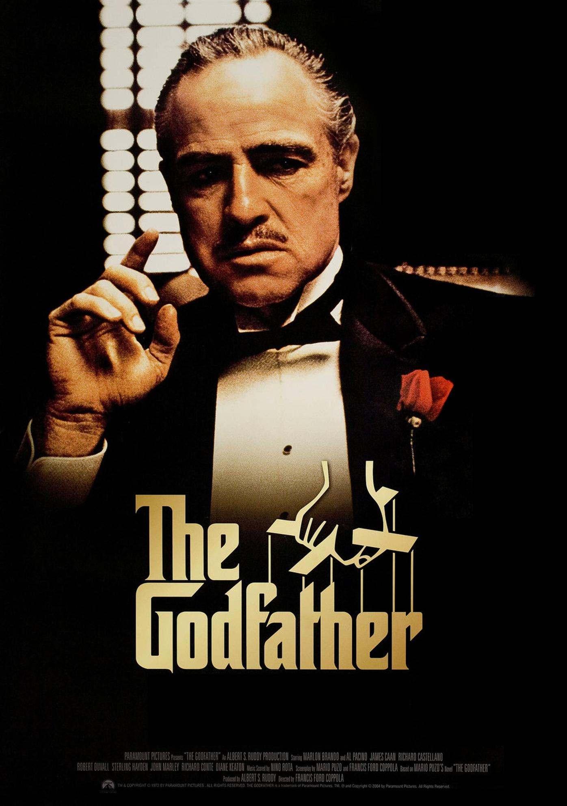
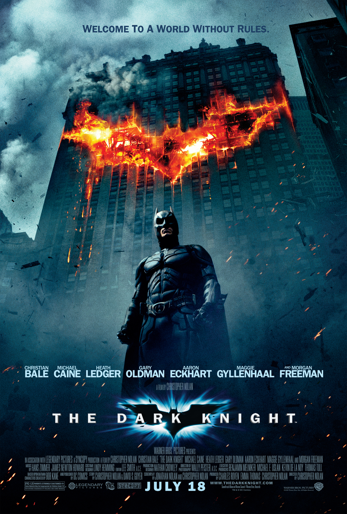
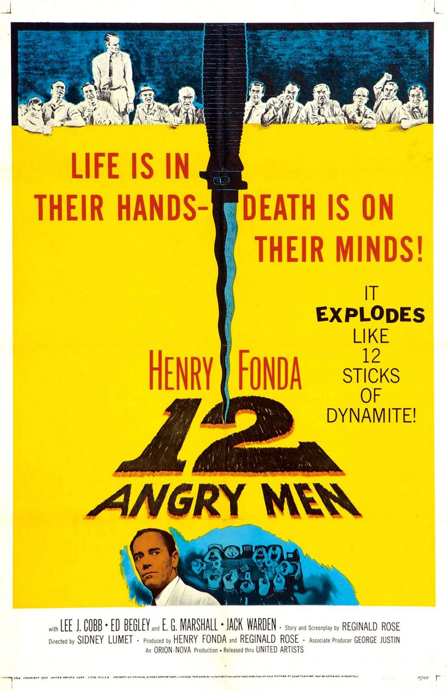
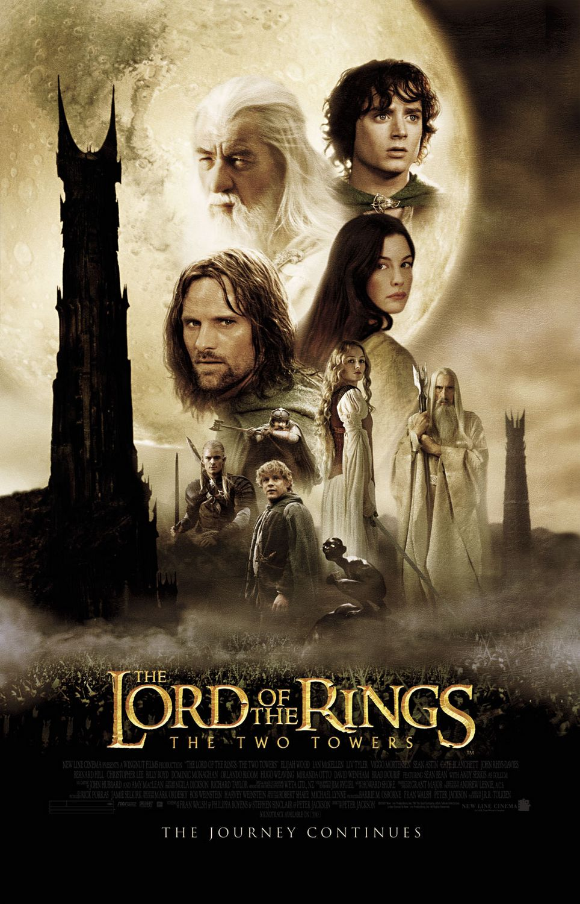

# IMDb Top 250 Movies Dataset & Poster Archive

A complete, structured, and enriched dataset of the **IMDb Top 250 Movies**, including full metadata, official high-resolution movie posters, insights, and an interactive web viewer.

---

## 📊 Dataset Overview

- **Total Titles**: 250 feature films
- **Average IMDb Rating**: 8.31 / 10
- **Highest Rating**: 9.3 (*The Shawshank Redemption*)
- **Average Runtime**: 133 minutes (2h 13m)
- **Total Votes Represented**: ~195.6 Million votes
- **Posters Downloaded**: 250/250 (100% complete, ~245 MB high-resolution archive)

---

## 📁 Repository Structure

```text
├── imdb_top_250.csv           # Complete dataset in CSV format
├── imdb_top_250.json          # Complete dataset in JSON format
├── imdb_top_250.xlsx          # Formatted Excel spreadsheet
├── imdb_top_250.html          # Interactive HTML viewer with search, sorting & poster zoom
├── chart_insights_and_news.json # Chart rules, insights, and trending news
├── posters/                   # 250 high-resolution movie posters (001_... to 250_...)
├── parse_imdb.py              # Script to extract and parse movie data
├── download_posters.py        # Concurrent multi-threaded poster downloader
└── generate_html.py           # HTML table generator with responsive styling
```

---

## 🎬 Top 10 Preview

| Rank | Poster | Title | Year | Runtime | Cert | Rating | Votes |
| :---: | :---: | :--- | :---: | :---: | :---: | :---: | :---: |
| **#1** |  | [The Shawshank Redemption](https://www.imdb.com/title/tt0111161/) | 1994 | 2h 22m | 15 | ⭐ 9.3 | 3.3M |
| **#2** |  | [The Godfather](https://www.imdb.com/title/tt0068646/) | 1972 | 2h 55m | 15 | ⭐ 9.2 | 2.3M |
| **#3** |  | [The Dark Knight](https://www.imdb.com/title/tt0468569/) | 2008 | 2h 32m | 12A | ⭐ 9.1 | 3.3M |
| **#4** |  | [The Godfather Part II](https://www.imdb.com/title/tt0071562/) | 1974 | 3h 22m | X | ⭐ 9.0 | 1.5M |
| **#5** |  | [The Lord of the Rings: The Return of the King](https://www.imdb.com/title/tt0167260/) | 2003 | 3h 21m | 12A | ⭐ 9.0 | 2.2M |
| **#6** |  | [12 Angry Men](https://www.imdb.com/title/tt0050083/) | 1957 | 1h 36m | U | ⭐ 9.0 | 1.0M |
| **#7** |  | [Schindler's List](https://www.imdb.com/title/tt0108052/) | 1993 | 3h 16m | 15 | ⭐ 9.0 | 1.6M |
| **#8** |  | [The Lord of the Rings: The Fellowship of the Ring](https://www.imdb.com/title/tt0120737/) | 2001 | 2h 58m | PG | ⭐ 8.9 | 2.3M |
| **#9** |  | [Pulp Fiction](https://www.imdb.com/title/tt0110912/) | 1994 | 2h 34m | 18 | ⭐ 8.8 | 2.5M |
| **#10** |  | [The Lord of the Rings: The Two Towers](https://www.imdb.com/title/tt0167261/) | 2002 | 2h 59m | 12A | ⭐ 8.8 | 2.0M |

---

## 🗂️ Data Schema

Each entry contains the following fields:

| Field | Type | Description |
| :--- | :--- | :--- |
| `rank` | `integer` | IMDb chart ranking (1 to 250) |
| `title` | `string` | Movie title |
| `imdb_id` | `string` | IMDb title identifier (e.g. `tt0111161`) |
| `year` | `integer` | Year of theatrical release |
| `duration` | `string` | Formatted runtime (e.g. `2h 22m`) |
| `duration_minutes` | `integer` | Total runtime converted to minutes |
| `certificate` | `string` | Age rating / classification |
| `rating` | `float` | Weighted IMDb user score (e.g. `9.3`) |
| `votes_display` | `string` | Number of user votes formatted (e.g. `3.3M`) |
| `votes_count` | `integer` | Estimated total vote count (e.g. `3300000`) |
| `imdb_url` | `string` | Direct link to IMDb title page |
| `poster_url` | `string` | Remote URL for official poster image |
| `local_poster_path` | `string` | Relative path to local downloaded poster in `posters/` |

---

## 🚀 Quick Start

### 1. Interactive Web Viewer
Open `imdb_top_250.html` directly in your favorite browser to search, filter by certificate or year, sort by rating/runtime/votes, and preview posters.

### 2. Python / Pandas
```python
import pandas as pd

df = pd.read_csv('imdb_top_250.csv')
print(df.head())
```

---

## 📜 Chart Inclusion Rules
According to IMDb ranking methodology:
- Only feature films are included (shorts, TV movies, and documentaries are excluded).
- The list is ranked by a formula including the number and weighted value of ratings from regular users.
- A film must receive at least 25,000 ratings to be eligible.
